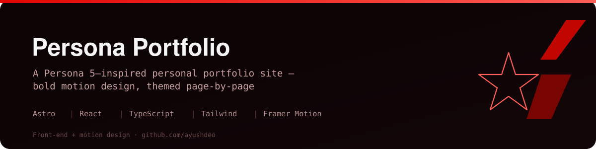

<p align="center">
  
</p>

<p align="center">
  
  
  
  
  
</p>

# Persona Portfolio

> A personal portfolio site with a **Persona 5–inspired** visual identity — high-contrast reds, angular masks, and animated transitions — built as an Astro islands app with React and Framer Motion.

This is a design-forward front-end project: the goal was a portfolio that *feels* like a product, with a consistent themed design system rather than a template.

---

## 🎭 Themed pages

Each route is styled around the game's metaphor:

| Route | Purpose |
|---|---|
| `index` | Landing / hero with animated intro |
| `arsenal` | Projects & skills showcase (`ProjectCard`, `MissionVisuals`) |
| `stats` | Skills as a radar chart (`StatRadar`, `StatCard`) |
| `confidants` | Collaborations / network (`ConfidantDeck`) |
| `safe-room` | About / contact |

## 🧱 How it's built

- **Astro islands** — static-first pages that hydrate only the interactive React components, so the site stays fast.
- **Custom design system** — reusable UI in `src/components/ui/` (`PersonaButton`, `MaskReveal`, `SlashDivider`, `ChaosBackground`, `USCOverlay`) with a dedicated `persona.css`.
- **Motion** — `framer-motion` powers page transitions (`PageTransition.tsx`) and reveal animations.
- **Layout** — shared `PersonaLayout`, `SideNav`, and `TopBar` for consistent navigation.

```
src/
├── components/
│   ├── layout/   # PersonaLayout, SideNav, TopBar
│   ├── motion/   # PageTransition
│   └── ui/       # cards, buttons, radar, mask reveals, backgrounds
├── pages/        # index · arsenal · stats · confidants · safe-room
└── styles/       # global + persona theme
```

## ▶️ Run

```bash
npm install
npm run dev       # local dev server (astro dev --host)
npm run build     # production build
npm run preview   # preview the build
```

## 🧰 Tech stack

`Astro` · `React` · `TypeScript` · `Tailwind CSS` · `Framer Motion` · `clsx` / `tailwind-merge`

---

<sub>Author: **Ayush Deo** · [github.com/ayushdeo](https://github.com/ayushdeo) · Front-end & motion design</sub>
